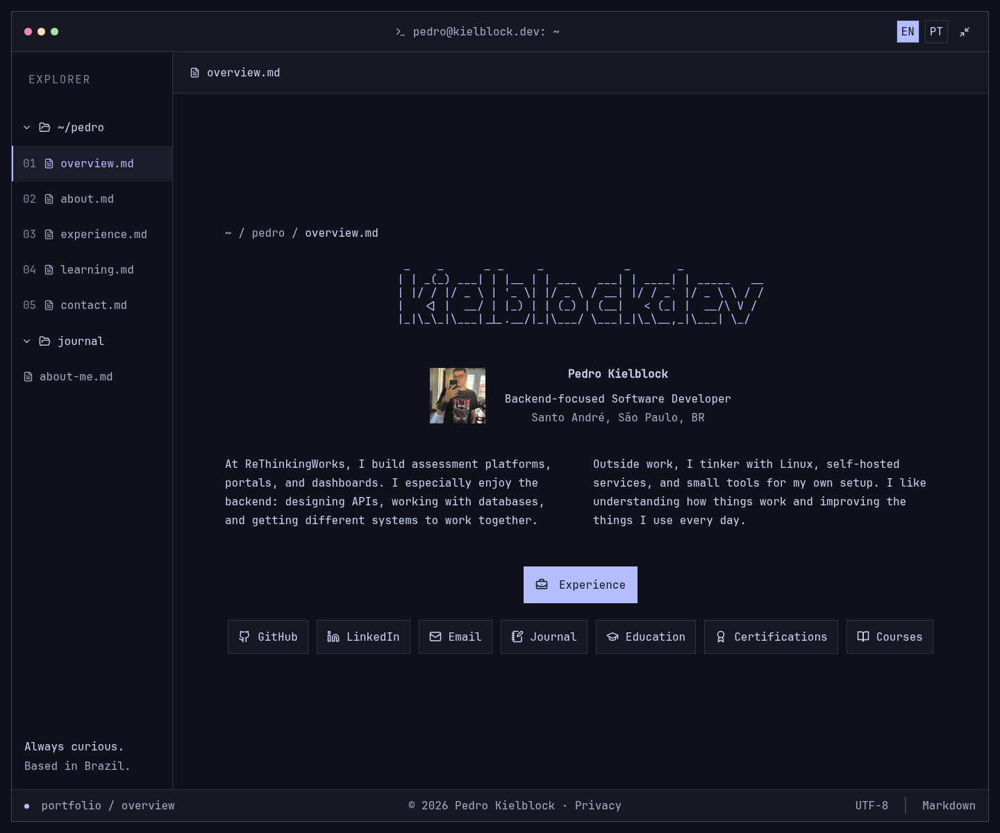

# Portfolio

A personal portfolio built with SvelteKit 3, Svelte 5, TypeScript 6, and Tailwind CSS, deployed on Vercel. The build uses Vite 8. The workspace uses Svelte 5 state and derived values; shared components retain supported legacy syntax.

## Interface

The portfolio uses a square terminal-style window with Catppuccin Mocha Crust surfaces, Lavender accents, and locally hosted JetBrains Mono at 16px. The expanded terminal fills the viewport height with equal top and bottom margins; no space is reserved for an outer homepage footer. A `kielblockdev` ASCII wordmark sits above the profile. The name heading reads `Pedro Kielblock` without a trailing cursor, alongside the real profile photo and backend role. Section headings lead directly into their content; repeated decorative comments are omitted. Contact uses a direct email invitation. Icon buttons link to GitHub, LinkedIn, email, journal, education, certifications, and courses; the learning shortcuts open their category directly. It is a clickable website: file-style navigation opens overview, about, experience, learning, and contact views. Experience entries expand, certifications link to their official exam pages, learning categories switch, the window expands, and the email address can be copied. About groups the GitHub and LinkedIn buttons together; Contact provides email and its copy button. There is no command prompt.

Navigation uses URL fragments, so sections can be linked directly. The explorer has two collapsible folders: `~/pedro` contains the portfolio sections, and `journal` lists published Markdown entries. Selecting an entry opens it in the document pane; direct links use `/#journal/<slug>`. Both folders support mouse and keyboard controls on desktop and mobile. The outer workspace heading, tagline, and GitHub bar have been removed. The status bar links to the bilingual privacy policy at `/privacy`. The workspace opens expanded by default and fills the desktop viewport with small outer margins. Content is centered in the document pane, with a two-column introduction on wide screens. On mobile, every section link remains visible in a navigation grid, a compact ASCII wordmark fits the screen, and content scrolls naturally with the page. Keyboard navigation, visible focus, and reduced-motion preferences are supported. The journal and privacy routes share the same theme. A matching SVG terminal favicon uses Crust and Lavender. On opening the homepage, a 3.5-second CSS sequence types `open overview.md` (or `open visão-geral.md` in Portuguese), pauses, then reveals the workspace; it does not block interaction or use timers or browser storage. The homepage copyright sits in the bottom status bar and stays hidden with the workspace during the opening sequence. Other routes retain their page footer. Reduced-motion users see the workspace immediately. The homepage browser title is `pedro@kielblockdev`. The introduction covers work at ReThinkingWorks and personal interests in Linux, self-hosting, and small tools.

## Languages and course certificates

English and Brazilian Portuguese are available throughout the portfolio, journal, and privacy page. On the first visit, the browser’s preferred language selects Portuguese for any `pt` locale and English otherwise. The EN/PT controls switch immediately and save only a manual selection in `portfolio-language` in localStorage. That choice takes precedence on later visits; clearing site data restores browser detection. Switching remains usable when storage is blocked. URL fragments stay stable across languages, while navigation labels and dates are localized.

UI and resume translations live in `src/lib/i18n/en.json` and `pt-BR.json`. The privacy policy uses `src/lib/i18n/privacy.json`. The existing journal entry has a Portuguese Markdown version in `src/content/pt-BR/about-me.md`; add and wire a matching translation when publishing another entry.

Course entries open locally hosted certificate PDFs in a new tab. The Java entry selects its English or Portuguese certificate and also links to the Udemy course. The IoT entry opens its original Portuguese certificate in either interface language. Certificate files live in `static/certificates/`; link data lives in `src/lib/data/resume.ts`.

## Development

```sh
bun install --frozen-lockfile
bun run dev
```

Edit portfolio content in `src/lib/data/resume.ts`, the homepage in `src/routes/+page.svelte`, and shared styling in `src/app.css`. Journal entries live in `src/content/*.md`: use frontmatter fields `title`, `description`, `date` (`YYYY-MM-DD`), `categories`, and `published: true`. The filename becomes the journal filename and URL slug; entries appear newest first. Existing `/blog` routes remain available. Journal Markdown is trusted repository content compiled at build time. Card descriptions pass through an HTML sanitizer before rendering. No environment variables are required.

```sh
bun run check
bun run lint
bun test tests/markdown.test.ts tests/i18n.test.ts
bun run build
bun audit
```

Vercel uses the build and install commands in `vercel.json`. The framework, Vercel adapter, and Markdown preprocessor are configured in `vite.config.ts`; application imports use the native `#lib` package alias. `postcss-selector-parser` is overridden to the patched 6.1.5 release because the typography plugin pins an older version; remove the override when that upstream pin is fixed. Images use ordinary local asset imports; no image-optimization plugin or Sharp dependency is needed. The site includes no analytics, tracking cookies, or third-party font requests. The privacy policy remains a draft: its provider, transfer, and retention details require owner review.

The browser regression script uses an existing Playwright installation and Chromium executable, without adding either to the application dependencies. Start the production preview with `bun run preview`, then run:

```sh
PREVIEW_URL=http://127.0.0.1:4173 bun tests/portfolio.browser.mjs /absolute/path/to/playwright/index.mjs /absolute/path/to/chromium
```

It checks the served SVG favicon, workspace opening animation and reduced-motion fallback, section navigation, collapsible explorer folders, journal Markdown rendering and deep links, history, expandable roles, learning categories, clipboard success and failure, window expansion, mobile overflow at 320/360/390/430/768px, landscape navigation, desktop viewport fill and content centering, reduced motion, keyboard focus, journal/privacy routes, browser-language detection, manual switching and reload persistence, blocked browser storage, certificate PDF responses, Udemy links, and Portuguese mobile overflow. It also refreshes the desktop and mobile screenshots in `docs/`.

## Preview



[Wide desktop](docs/portfolio-wide.png) · [Mobile](docs/portfolio-mobile.png) · [Journal](docs/journal.png) · [Opening sequence](docs/workspace-opening.png)

[About](docs/about.png) · [Contact](docs/contact.png) · [Certifications](docs/certifications.png) · [Courses](docs/courses.png) · [Portuguese](docs/portfolio-portuguese.png)

## Credits

Originally based on the Magic UI portfolio template. JetBrains Mono is distributed under the SIL Open Font License; see `static/fonts/OFL.txt`.
