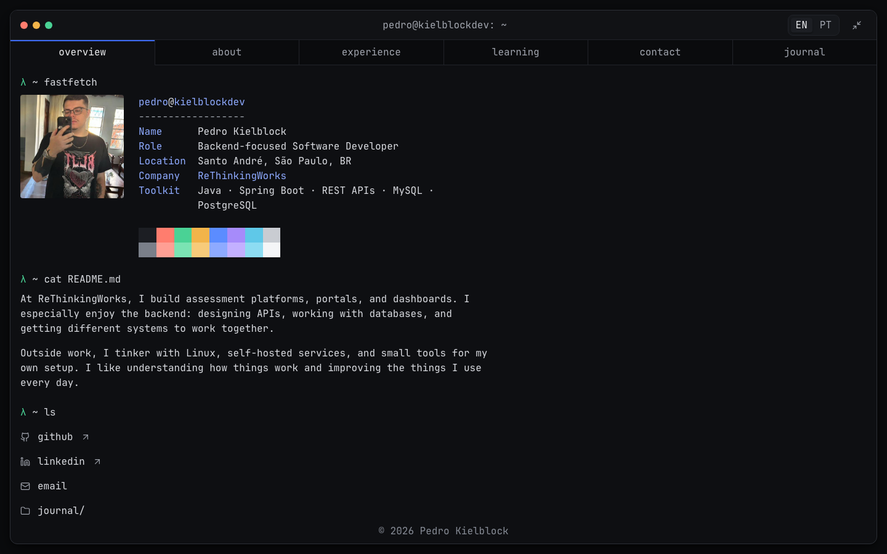

# Portfolio

A personal portfolio built with SvelteKit 3, Svelte 5 and TypeScript 6, deployed on Vercel. The build uses Vite 8. Styling is Kiel UI: `src/kiel-ui.css` is vendored unchanged from the design system and `src/app.css` holds the site's own rules.

## Interface

The site is one terminal window in the Kiel Dark palette, set in locally hosted JetBrains Mono at 16px on a 24px row. The window has a title bar, a tab per section (overview, about, experience, learning, contact, journal) and a screen that scrolls. Each section is the output of a command typed at a `λ ~` prompt:

- **overview** runs `fastfetch`: the profile photo beside name, role, location, company and toolkit, with the 16 terminal colors below. `cat README.md` prints the introduction and `ls` lists links to GitHub, LinkedIn, email, the journal and the three learning categories.
- **about**, **experience** and **contact** print a Markdown-style file. Roles expand, and the email address can be copied.
- **learning** switches between education, certifications and courses. Certifications link to their official exam pages.
- **journal** lists published Markdown entries; selecting one prints it. Direct links use `/#journal/<slug>`.

Navigation uses URL fragments, so every section can be linked directly; `#education`, `#certifications` and `#courses` open the learning tab on that category. The old `/blog` and `/blog/<slug>` addresses redirect to the journal. An unknown address prints a shell-style "No such file or directory" with a red prompt and a link home.

On opening, a CSS-only sequence of about 1.7 seconds shows the window opening, types the first command key by key, then prints its output; it plays once per visit, on whichever section the link opens, and is skipped for reduced-motion users. The window opens filling the viewport; the button in the title bar restores it to 1152 × 720. Below 900px the window fills the page, the tabs wrap into a grid and the page scrolls. The theme is dark only, like the terminal palette it uses. Keyboard navigation, visible focus, a skip link and reduced-motion preferences are supported. The favicon is the prompt (a lambda and a block cursor) on the Kiel UI accent color, as SVG with a PNG fallback.

## Languages and course certificates

English and Brazilian Portuguese are available throughout the portfolio and journal. On the first visit, the browser’s preferred language selects Portuguese for any `pt` locale and English otherwise. The EN/PT controls switch immediately and save only a manual selection in `portfolio-language` in localStorage. That choice takes precedence on later visits; clearing site data restores browser detection. Switching remains usable when storage is blocked. URL fragments stay stable across languages, while navigation labels and dates are localized.

UI and resume translations live in `src/lib/i18n/en.json` and `pt-BR.json`. The existing journal entry has a Portuguese Markdown version in `src/content/pt-BR/about-me.md`; add and wire a matching translation when publishing another entry.

Course entries open locally hosted certificate PDFs in a new tab. The Java entry selects its English or Portuguese certificate and also links to the Udemy course. The IoT entry opens its original Portuguese certificate in either interface language. Certificate files live in `static/certificates/`; link data lives in `src/lib/data/resume.ts`.

## Development

```sh
bun install --frozen-lockfile
bun run dev
```

Edit portfolio content in `src/lib/data/resume.ts`, the sections in `src/routes/+page.svelte`, the window in `src/routes/+layout.svelte`, and styling in `src/app.css`. Update `src/kiel-ui.css` only by copying the new file from the Kiel UI design system. Journal entries live in `src/content/*.md`: use frontmatter fields `title`, `description`, `date` (`YYYY-MM-DD`), `categories`, and `published: true`. The filename becomes the journal filename and URL slug; entries appear newest first. Journal Markdown is trusted repository content compiled at build time. No environment variables are required.

```sh
bun run check
bun run lint
bun test tests/markdown.test.ts tests/i18n.test.ts tests/sections.test.ts
bun run build
bun audit
```

Vercel uses the build and install commands in `vercel.json`. The framework, Vercel adapter, and Markdown preprocessor are configured in `vite.config.ts`; application imports use the native `#lib` package alias. Images use ordinary local asset imports; no image-optimization plugin or Sharp dependency is needed. Fonts are self-hosted.

Tailwind CSS, its config and the template components in `src/lib/components/{ui,magic,portfolio}` are left over from the original template. Nothing on the site uses them.

The browser regression script uses an existing Playwright installation and Chromium executable, without adding either to the application dependencies. Start the production preview with `bun run preview`, then run:

```sh
PREVIEW_URL=http://127.0.0.1:4173 bun tests/portfolio.browser.mjs /absolute/path/to/playwright/index.mjs /absolute/path/to/chromium
```

It checks the theme and font, favicon, tabs, overview links, every section, learning categories, clipboard success and failure, window size, history, the skip link, deep links, the journal, old blog links, the 404 page, sideways scroll and clipped tabs at 320/360/390/430/768px, landscape, three desktop sizes, reduced motion, browser-language detection, manual switching and reload persistence, blocked browser storage, certificate PDF responses and course links. It also refreshes the screenshots in `docs/`.

## Preview



[Wide desktop](docs/portfolio-wide.png) · [Mobile](docs/portfolio-mobile.png) · [Journal](docs/journal.png)

[About](docs/about.png) · [Contact](docs/contact.png) · [Certifications](docs/certifications.png) · [Courses](docs/courses.png) · [Portuguese](docs/portfolio-portuguese.png)

## Credits

Originally based on the Magic UI portfolio template. JetBrains Mono is distributed under the SIL Open Font License; see `static/fonts/OFL.txt`.
